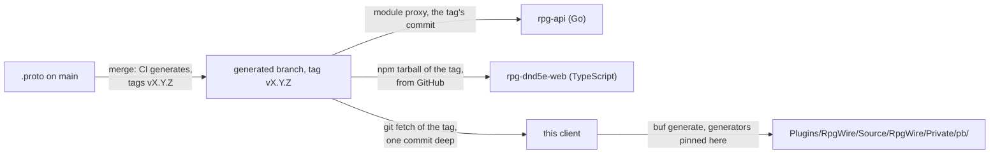

# rpg-dnd5e-unreal

The Unreal client of the RPG engine. A second client beside
[rpg-dnd5e-web](https://github.com/KirkDiggler/rpg-dnd5e-web), shaped like
the first: generated code from the same protos, the same auth boundary,
the same seat gates, the same verbs in and record out. It opens no door of
its own, and the engine gains nothing for its sake.

The design is law in `rpg-project`,
[ideas/unreal-client/design.md](https://github.com/KirkDiggler/rpg-project/blob/main/ideas/unreal-client/design.md),
with its rulings; the story that carries the work is
[rpg-project#1237](https://github.com/KirkDiggler/rpg-project/issues/1237):
one engine, every client; generated, never written; intent in, record out;
the same door; no side channel.

## State

Built from [the spike](https://github.com/KirkDiggler/rpg-project/pull/1155),
which proves the concept on Linux with Unreal 5.9: a real game started
from Unreal as a real player on the real stack, a click on the floor
walks, a click on a figure swings, the world answers, and every figure
moves only as the record says.

What is here is what the spike proves worth keeping: the core that speaks
to the engine, and the reading of a record beat. What is not here yet, in
order: a game mode to launch, content by reference, continuous integration
that builds the engine, platforms other than Linux.

## How the project is put together

An Unreal project is a **project** that lists **modules**, each a compiled
unit with its own dependencies, grouped where it helps into **plugins**. No
makefile: the engine's build tool reads a descriptor for each and writes
the build. For this repository they read:

```
RpgDnd5eUnreal.uproject            the project. Its name is the project's,
                                   every target's and the module's
Config/
  DefaultEngine.ini                which map opens, which Game Mode runs it
Source/
  RpgDnd5eUnreal.Target.cs         build the game: which modules, how
  RpgDnd5eUnrealEditor.Target.cs   build the editor's version of the same
  RpgDnd5eUnreal/
    RpgDnd5eUnreal.Build.cs        the game module's dependencies
    RpgDnd5eUnreal.h, .cpp         its entry point
Plugins/RpgWire/
  RpgWire.uplugin                  the plugin: its modules, and when each loads
  Source/
    RpgWire/
      RpgWire.Build.cs             the core's dependencies, the libraries among them
      Public/                      the headers another module may include:
                                   RpgSession.h, RpgLog.h
      Private/
        pb/                        the compiled contract, generated; 144 files
        RpgSession.cpp             sign in, start a game, send a verb
        RpgRecordStream.cpp        follow the record, live
        Tests/
    RpgClient/
      RpgMotion.h, .cpp            what a record beat means for figures
      Tests/
    ThirdParty/                    gRPC and protobuf; fetched, never committed
scripts/                           everything fetched or built goes through these
protos.ref                         the protos tag this client builds against
```

The game module is thin on purpose. The code is in the plugin, in two
modules:

| the module | owns | keeps |
|---|---|---|
| `RpgWire` | talking to the engine: a session, its verbs, the record as it arrives | plain C++; no Unreal type in `Public/` beyond the export macro; every call blocking, off the game thread |
| `RpgClient` | what a beat means: which cells a walk takes, where a swing lands | functions with no world in them, tested against beats the engine wrote |

Three Unreal rules give the tree its shape:

- **`Public/` is what other modules may include.** `Private/` is the
  module's own. `RpgSession.h` is public because the game module calls it.
- **Generated protobuf code cannot cross a module boundary.** Every Unreal
  module is its own shared library, and protobuf's generated symbols break
  across one. So `Private/pb/` compiles as part of `RpgWire`, not in a
  module of its own.
- **A `.Build.cs` is a module's dependency list.** It is C# the build tool
  runs; `RpgWire.Build.cs` is where the gRPC libraries get linked.

At run time, the game module calls `RpgSession`; `RpgSession` calls the
generated stubs in `pb/`, which speak gRPC to the engine; the record comes
back through `RpgRecordStream`; `RpgClient` turns each beat into motion.
The game module itself does little yet. The Game Mode is the next thing to
build.

## Where the contract comes from

One merge to the protos repository makes one tag, and every client takes
the contract from that tag:



The other two clients consume code the protos pipeline generates. This one
consumes the tag's *sources* and generates the C++ itself, with the two
plugins pinned in `buf.gen.yaml` (design ruling R8). The reason is the
runtime: generated C++ is bound to the protobuf and gRPC it links, and
those versions are this repository's to choose until R3 rules, so the
generators and the runtime are pinned side by side here. A bump is a
one-line change to `protos.ref`, as the web's is to its `package.json`.

`Private/pb/` is never committed and never edited: a field with the wrong
name is fixed in the protos and regenerated.

The libraries in `Source/ThirdParty/` are a pinned archive (gRPC 1.57.0,
protobuf 4.23.4). They are a stopgap until R3 rules on the libraries' own
build.

## Build and test

Needs Linux, Unreal Engine 5.9 and [`buf`](https://buf.build). No checkout
of the protos repository is needed.

```
scripts/bootstrap.sh     fetch the libraries, generate the contract, mount
                         content if rpg-game-assets is beside this repository
scripts/build.sh         build the editor target
scripts/test.sh          run the tests: the beat-reading always; the verbs
                         against the engine's test server when RPGWIRE_TEST_ADDR
                         and RPGWIRE_TEST_INFO are set
scripts/perfile-check.py compile every hand-written .cpp on its own
```

`UE_ROOT` says where the engine is, if not `~/UnrealEngine/UE_5.9`. To
work against a branch of the contract before it is published, set
`RPG_API_PROTOS_DIR` to a checkout of it: what is committed at its `HEAD`
is used, never a working tree.

The engine's test server is rpg-api's `TestUESpikeServe`, in
`internal/integration/session/`; it listens on `UE_SPIKE_ADDR` and writes
the runs' details to `UE_SPIKE_INFO`.

## Rules this repository keeps

- **No licensed content.** Nothing from Synty, no GLB or FBX, no engine
  content. Licensed models live in `rpg-game-assets`, the private store,
  and are mounted by `scripts/mount-content.sh`.
- **Nothing generated is edited.** The contract is generated from the
  protos at the tag in `protos.ref`; the libraries are fetched, pinned by
  hash.
- Work in a worktree; attribute as your team; the paper trail is issues
  and pull requests.

Start in [CLAUDE.md](CLAUDE.md).
